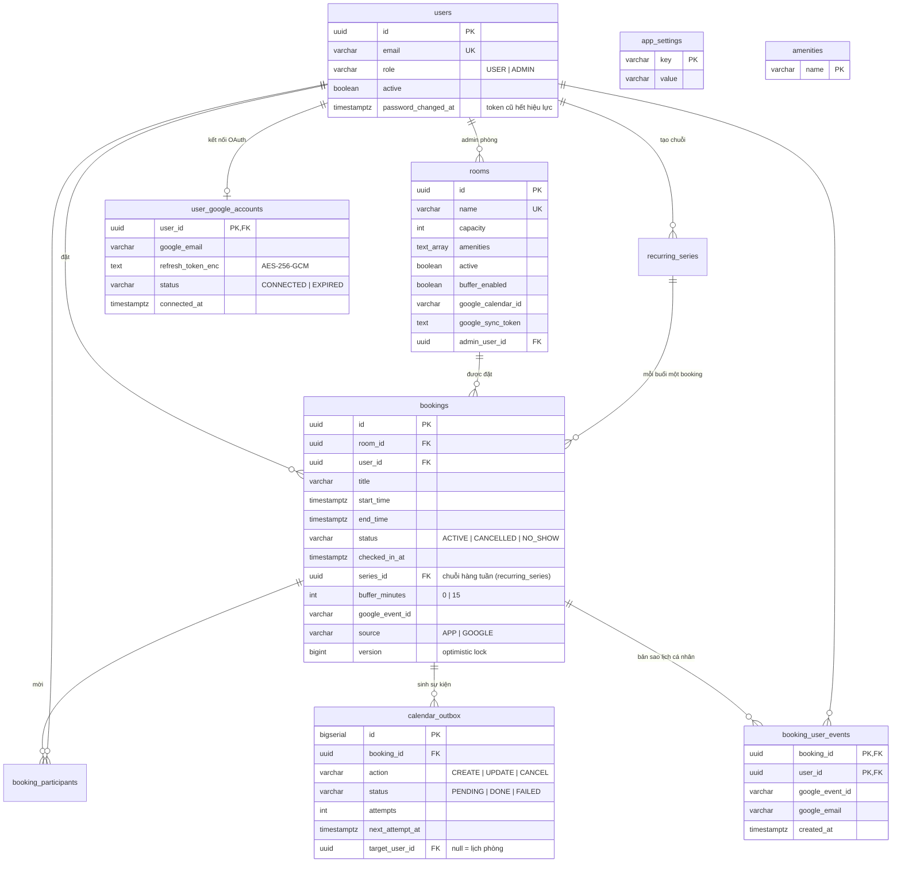

# Meeting Room Booking System — DKI Coding Test

Backend REST API (kèm Web UI demo) cho hệ thống đặt phòng họp nội bộ: công ty ~10 phòng họp,
~200 nhân viên, trước đây đặt phòng bằng nhắn tin nên thường xuyên trùng lịch. Hệ thống này là
nguồn sự thật duy nhất về lịch phòng: quản lý phòng, đặt phòng, xem lịch, tìm phòng trống,
phân quyền người dùng thường / quản trị — và chống trùng lịch tuyệt đối ở tầng database.

Ngoài yêu cầu đề bài, hệ thống có thêm: đồng bộ **hai chiều** với Google Calendar (mỗi phòng
một lịch), buffer time giữa hai cuộc họp bật/tắt theo phòng, mời người tham gia và gửi email
thông báo, check-in / tự thu hồi phòng khi không ai đến (NO_SHOW), và đặt lịch định kỳ
hàng tuần (buổi trùng được bỏ qua và báo lại — partial success).

**Stack:** Java 17 · Spring Boot 3.5 · PostgreSQL 16 · Flyway · Docker Compose · React 19 + Vite · Testcontainers

---

## 1. Cách chạy

### Một lệnh duy nhất

```bash
git clone https://github.com/pxthinh/interview-dki.git && cd interview-dki
docker compose up -d --build
```

Chạy nền; lần đầu build backend + frontend mất vài phút. Không cần file `.env`, không cần cấu
hình gì: mọi biến có default trong `docker-compose.yml` (danh sách trong `.env.example`; các biến
tinh chỉnh hiếm dùng như `GOOGLE_CALENDAR_POLL_INTERVAL_MS`, `GOOGLE_CALENDAR_IMPORT_INTERVAL_MS`,
`GOOGLE_CALENDAR_PRESYNC_TIMEOUT_MS` chỉ có trong `application.yml`).

| Thành phần | URL |
|---|---|
| Web UI (React qua nginx) | http://localhost:3000 |
| API | http://localhost:8080/api/v1 |
| Swagger UI — mô tả và thử từng API | http://localhost:8080/swagger-ui.html |
| Health | http://localhost:8080/actuator/health |
| Mailpit — hộp thư demo nhận email thông báo | http://localhost:8025 |

Chạy xong là thử được ngay:

- **Email thông báo** (mời họp, hủy, thu hồi no-show, chuỗi định kỳ) đi vào Mailpit tại
  http://localhost:8025 — không gửi ra ngoài.
- **Đồng bộ Google Calendar bật sẵn** bằng service account demo (`secrets/google-sa.json`, lý
  do ở mục dưới). Phòng **Earth** được gắn sẵn lịch demo (migration `V3`): đặt / sửa / hủy phòng
  Earth sẽ đẩy lên Google (theo dõi ở trang **Calendar sync** của admin), sự kiện tạo thẳng trên
  lịch đó được kéo về thành booking `[CALENDAR] ...`. Tạo phòng mới thì hệ thống tự tạo lịch. Nếu
  key demo đã bị thu hồi, mọi tính năng khác vẫn chạy bình thường — chỉ các dòng đồng bộ chuyển
  FAILED ở trang Calendar sync.
- **Google Calendar cá nhân (OAuth từng người)** tắt mặc định vì cần OAuth client riêng (mục
  "Bật/tắt tính năng").

```bash
docker compose logs -f app      # xem log backend
docker compose down             # dừng, giữ dữ liệu
docker compose down -v          # dừng và xóa DB: lần chạy sau seed lại từ đầu
# tùy chọn: 200 user + 3 đến 5 booking/phòng/ngày trong 20 ngày (5 ngày trước, hôm nay, 14 ngày tới).
# Chạy lại được: chỉ xóa/ghi đè booking có tiền tố "[Seed] ", không đụng booking thật.
# Thêm -v SEED_SYNC=1 (hoặc -Sync với file .ps1) nếu muốn đẩy booking seed lên Google Calendar.
# Bash / Linux / macOS:
docker compose exec -T db psql -v ON_ERROR_STOP=1 -U roombooking -d roombooking < scripts/seed-load-test.sql
# Windows (PowerShell) - chạy 1 trong 2 lệnh:
.\scripts\seed-load-test.ps1
# hoặc:
docker compose cp scripts/seed-load-test.sql db:/tmp/seed-load-test.sql; docker compose exec -T db psql -v ON_ERROR_STOP=1 -U roombooking -d roombooking -f /tmp/seed-load-test.sql
```

### Vì sao repo chứa key Google

Repo phục vụ bài test phỏng vấn nên service account key được **cố ý commit**
(`secrets/google-sa.json`):

- **Mục đích:** người chấm chạy và thử đủ tính năng — kể cả đồng bộ hai chiều với Google
  Calendar — bằng đúng một lệnh, không phải tự tạo Google Cloud project, service account và
  share lịch.
- **Phạm vi hẹp:** đây là service account riêng cho bài test
  (`interview-dki@my-project-61423-1690767816118.iam.gserviceaccount.com`), không có IAM role
  nào trong project; quyền duy nhất của nó là sửa lịch demo đã được share cho nó. Lộ key chỉ
  ảnh hưởng tới lịch demo này.
- **Có thời hạn:** key sẽ bị xóa sau buổi phỏng vấn. Khi đó thay bằng key của bạn: đặt file mới
  vào `secrets/google-sa.json`, share lịch cho email service account đó, gán Calendar ID cho phòng.
- **Không commit:** file `.env` (cấu hình cá nhân, ví dụ app password Gmail — cho phép đọc toàn
  bộ hộp thư nên tuyệt đối không công khai) và OAuth client secret. Email demo đã đi qua Mailpit
  nên không cần credential SMTP thật.
- Cách làm này chỉ dành cho demo; dự án thật giữ mọi secret ngoài git (biến môi trường / secret
  manager).

### Tài khoản mẫu (tự seed khi DB trống)

| Email | Mật khẩu | Vai trò |
|---|---|---|
| `admin@dki.local` | `Admin@123` | ADMIN |
| `alice@dki.local`, `bob@dki.local`, `carol@dki.local` | `User@123` | USER |

10 phòng mẫu seed bằng Flyway: Mercury (4 chỗ) → Jupiter (20 chỗ).

### Chạy test và phát triển

Chỉ cần khi sửa code — để chạy thử, lệnh ở trên là đủ.

```bash
mvn test                                    # toàn bộ test; cần Docker (Testcontainers kéo postgres:16),
                                            # Google được giả lập nên không gọi API thật
docker compose up -d db mailpit             # chỉ hạ tầng, rồi:
mvn spring-boot:run                         # backend local :8080
cd frontend && npm install && npm run dev   # frontend :5173, proxy /api sang :8080
```

Backend chạy ngoài Docker dùng default của `application.yml`: email và đồng bộ Google **tắt**
cho tới khi đặt biến môi trường tương ứng (`MAIL_ENABLED` — Mailpit nhận SMTP ở `localhost:1025`,
`GOOGLE_CALENDAR_ENABLED`, `GOOGLE_SERVICE_ACCOUNT_KEY_PATH=secrets/google-sa.json`).

### Bật/tắt tính năng (qua file `.env`, xem `.env.example`)

- **Google Calendar sync**: bật sẵn với key demo. Tắt hẳn: `GOOGLE_CALENDAR_ENABLED=false`.
  `GOOGLE_CALENDAR_INVITE_BOOKER=true` thêm người đặt làm attendee của sự kiện (cần
  `GOOGLE_IMPERSONATE_USER=<user Workspace>` vì service account thường không được mời khách).
  Dùng lịch riêng: share lịch phòng cho email service account quyền "Make changes to events",
  gán Calendar ID qua `PUT /rooms/{id}`; phòng mới tạo khi để trống Calendar ID thì hệ thống tự
  tạo lịch.
- **Google Calendar cá nhân (OAuth2 từng người)**: Google Cloud Console → OAuth client loại
  *Web application*, scope `calendar.events` + `openid` + `email`, Authorized redirect URI
  `http://localhost:3000/api/v1/integrations/google/callback` (dev vite: cổng 5173). Đặt
  `GOOGLE_OAUTH_ENABLED=true GOOGLE_OAUTH_CLIENT_ID=... GOOGLE_OAUTH_CLIENT_SECRET=...` và
  `GOOGLE_OAUTH_TOKEN_KEY` — sinh **một lần** bằng `openssl rand -base64 32` rồi lưu cố định
  trong `.env` (đổi key là mọi refresh token đã lưu không giải mã được: các kết nối chuyển
  EXPIRED, người dùng phải kết nối lại). Mỗi nhân viên vào **Tài khoản → Kết nối Google
  Calendar**; ngay khi kết nối, các cuộc họp sắp tới được đồng bộ, và từ đó mọi cuộc họp họ đặt
  hoặc được mời — kể cả thay đổi làm trực tiếp trên lịch phòng — được đẩy bản sao vào lịch
  Google cá nhân (một chiều). Không tạo bản sao cho người đặt khi họ đã có sự kiện gốc: cuộc
  họp tạo thẳng trên Google, hoặc đang bật `GOOGLE_CALENDAR_INVITE_BOOKER`. Bản sao có event ID
  suy ra từ (booking, người dùng) nên không bao giờ bị nhân đôi. Khóa tài khoản nhân viên thì
  liên kết Google của họ bị gỡ và token bị thu hồi. Callback OAuth chỉ chấp nhận từ đúng trình
  duyệt đã bấm Kết nối (cookie HttpOnly). Khi bật tính năng, app kiểm tra cấu hình ngay lúc khởi
  động (thiếu client id/secret/redirect URI hay key không phải 32 byte base64 là dừng). Độc lập
  với Service Account sync; toggle "Đồng bộ Google Calendar" trong trang Cấu hình **tạm dừng**
  cả hai: thay đổi trong lúc tạm dừng vẫn xếp hàng và được đẩy khi bật lại. **Lưu ý:** app OAuth
  ở chế độ *Testing* của Google chỉ cho tối đa 100 test user và refresh token hết hạn sau 7 ngày (người dùng thấy trạng thái EXPIRED và nút
  "Kết nối lại"); dùng thật cần publish + verify app với Google.
- **Check-in / no-show**: bật mặc định. Chỉnh qua `CHECKIN_ENABLED`, `CHECKIN_GRACE_MINUTES`
  (mặc định 15), `CHECKIN_EARLY_WINDOW_MINUTES` (mặc định 5), `CHECKIN_SWEEP_INTERVAL_MS`.
- **Email thật qua Gmail**: đặt trong `.env` (không commit) `MAIL_HOST=smtp.gmail.com
  MAIL_PORT=587 MAIL_SMTP_AUTH=true MAIL_STARTTLS=true MAIL_USERNAME=<gmail>
  MAIL_PASSWORD=<app password> MAIL_FROM=<gmail>`. Mặc định mail đi vào Mailpit để xem demo;
  `MAIL_ENABLED=false` tắt hẳn (hoặc tắt lúc chạy bằng toggle trong trang Cấu hình).

---

## 2. Thiết kế

### 2.1. Kiến trúc

```
┌──────────────┐   /api/v1 (JWT)    ┌─────────────────────────────┐
│  React SPA   │ ─────────────────▶ │  Spring Boot 3 (Java 17)    │
│ (nginx :3000 │ ◀───────────────── │  auth · user · room ·       │
│  proxy /api) │   JSON / RFC7807   │  booking · calendar         │
└──────────────┘                    └──┬─────────┬─────────┬──────┘
                                       │JPA      │outbox10s│ mail (async)
                                       │Flyway   │import30s│
                                       ▼         ▼         ▼
                                 ┌──────────┐ ┌─────────┐ ┌──────────────┐
                                 │PostgreSQL│ │ Google  │ │ SMTP         │
                                 │    16    │ │Calendar │ │ Mailpit/Gmail│
                                 └──────────┘ └─────────┘ └──────────────┘
```

Monolith một module, package theo domain (`auth`, `user`, `room`, `booking`, `calendar`,
`integrations` (OAuth lịch cá nhân), `settings`, `common`); mỗi domain controller → service → repository; DTO là record tách khỏi entity;
schema quản lý bằng Flyway (V1→V18). Ba job nền: outbox processor (đẩy sự kiện lên Google,
10s/lần), import job (kéo thay đổi từ Google về, 30s/lần) và no-show sweeper (quét thu hồi phòng
chưa check-in, 60s/lần). Email gửi async.

### 2.2. Mô hình dữ liệu



Thời gian: nghiệp vụ tính theo `Asia/Ho_Chi_Minh`, DB lưu UTC (`timestamptz`), API nhận/trả
ISO-8601 kèm offset. Không xóa cứng: phòng chỉ tắt (`active=false`), booking chỉ CANCELLED.

### 2.3. Quy tắc nghiệp vụ

| Quy tắc | Lỗi khi vi phạm |
|---|---|
| Căn lưới 15 phút (phút 00/15/30/45) | 422 `NOT_ON_15_MIN_GRID` |
| Kết thúc sau bắt đầu; thời lượng 15 phút – 8 giờ | 422 `END_BEFORE_START` / `DURATION_TOO_SHORT/_LONG` |
| Trong giờ làm việc 07:00–20:00, cùng một ngày | 422 `OUTSIDE_WORKING_HOURS` |
| Bắt đầu ở tương lai, tối đa 90 ngày tới | 422 `START_IN_PAST` / `TOO_FAR_AHEAD` |
| Số người tham dự ≤ sức chứa phòng | 422 `EXCEEDS_CAPACITY` |
| Phòng đang hoạt động (cả khi sửa booking) | 422 `ROOM_INACTIVE` |
| Không trùng giờ + buffer 15 phút giữa hai booking cùng phòng (bật/tắt theo phòng; khi hai booking có buffer khác nhau thì lấy buffer lớn hơn, áp cả hai phía) | 409 `BOOKING_CONFLICT` kèm `conflict` |
| Người tham gia là user active, không tính người đặt | 422 `PARTICIPANT_NOT_FOUND` |
| Sửa/hủy: chỉ chủ booking hoặc ADMIN; chỉ booking ACTIVE; sửa khi chưa bắt đầu; không hủy họp đã kết thúc; không đổi phòng | 403 / 422 `BOOKING_NOT_ACTIVE` / `BOOKING_ALREADY_STARTED` / `BOOKING_ALREADY_ENDED` |
| Check-in: người đặt hoặc người được mời, mở từ 5 phút trước giờ họp đến khi kết thúc; không check-in trong 15 phút đầu giờ → tự chuyển NO_SHOW, phòng được nhả (họp từ 15 phút trở xuống không bị thu hồi) | 422 `CHECKIN_TOO_EARLY` / `BOOKING_ALREADY_ENDED` |
| Đặt định kỳ hàng tuần, buổi cuối trong giới hạn đặt trước; buổi trùng bị bỏ qua và trả trong `skipped`; mọi buổi đều trùng → lỗi | 422 `RECURRING_ALL_CONFLICT` / `TOO_FAR_AHEAD` / `RECURRING_TOO_MANY_WEEKS` |
| Giới hạn đặt trước (mặc định 90 ngày) và số tuần tối đa của chuỗi (mặc định 26) do ADMIN chỉnh trong app_settings; booking đã đặt xa hơn mốc mới giữ nguyên | 422 `SETTING_OUT_OF_RANGE` khi admin nhập ngoài khoảng |
| Email duy nhất không phân biệt hoa thường (unique index `lower(email)`); mật khẩu 8 ký tự – 72 byte UTF-8 (giới hạn BCrypt) | 422 `EMAIL_TAKEN` / 400 validation |
| ADMIN không tự khóa / tự hạ quyền chính mình (admin khác làm) | 422 `SELF_DEMOTION` |
| Admin phòng phải là ADMIN đang hoạt động; tên phòng duy nhất không phân biệt hoa thường, tự trim; tiện nghi của phòng theo cùng luật danh mục, tối đa 20 | 422 `ROOM_ADMIN_INVALID` / `ROOM_NAME_TAKEN` / `AMENITY_INVALID_NAME` / `AMENITY_LIST_TOO_LONG` |

### 2.4. API

Base `/api/v1`, JWT Bearer (trừ login/health/swagger). Lỗi chuẩn RFC 7807 kèm `errorCode`
máy đọc được; 409 kèm chi tiết booking chiếm chỗ; lỗi validation kèm `errors[]`.
Chi tiết schema từng API: Swagger UI.

| Nhóm | Endpoint | Quyền | Ghi chú |
|---|---|---|---|
| Auth | `POST /auth/login` | public | → JWT hạn 8h |
| | `GET /auth/me` | user | user nạp lại từ DB mỗi request |
| Users | `POST /users`, `GET /users`, `GET /users/{id}`, `PATCH /users/{id}` | ADMIN | không self-signup; khóa tài khoản hiệu lực tức thì |
| | `POST /users/me/password` | user | đổi mật khẩu |
| | `GET /users/directory` | user | danh bạ rút gọn để chọn người mời họp |
| Rooms | `GET /rooms`, `GET /rooms/{id}` | user | |
| | `POST /rooms`, `PUT /rooms/{id}`, `PATCH /rooms/{id}/status` | ADMIN | tạo phòng: admin phòng mặc định là người tạo (phải là ADMIN đang hoạt động); sync bật + chưa có calendar id → tự tạo Google Calendar (cả khi PUT); PUT không gửi calendar id thì giữ id cũ; toggle buffer |
| | `GET /rooms/availability?start&end&minCapacity&amenities` | user | phòng trống (tính cả buffer), sắp sức chứa tăng dần |
| | `GET /rooms/time-slots?date[&start][&roomId][&excludeBookingId]` | user | nguồn cho picker giờ: giờ bắt đầu hợp lệ + số phòng trống; kèm `start` → giờ kết thúc hợp lệ; mốc kín toàn bộ phòng không trả về; `roomId`+`excludeBookingId` cho form sửa |
| | `GET /rooms/{id}/schedule?from&to` | user | lịch một phòng (≤31 ngày) |
| Bookings | `POST /bookings` | user | body gồm `participantIds[]` (≤ 50), `title` ≤ 200, `description` ≤ 2000 ký tự; 201; email xác nhận + thư mời |
| | `GET /bookings/{id}` | chủ/ADMIN | |
| | `PUT /bookings/{id}` | chủ/ADMIN | áp lại toàn bộ quy tắc; email cho người thêm/bỏ/giữ |
| | `POST /bookings/{id}/cancel` | chủ/ADMIN | soft-cancel; email báo hủy người tham gia |
| | `POST /bookings/{id}/check-in` | chủ/người được mời/ADMIN | xác nhận có mặt; idempotent; quá 15 phút đầu giờ chưa check-in → job nền chuyển NO_SHOW + email + gỡ sự kiện Google |
| | `POST /bookings/recurring` | user | đặt hàng tuần (body = đặt thường + `weeks` 2–26); 201 kèm `created[]` + `skipped[]` (partial success) |
| | `POST /bookings/series/{seriesId}/cancel` | người tạo chuỗi/ADMIN | hủy mọi buổi còn lại của chuỗi; buổi đã qua / đã hủy riêng giữ nguyên |
| | `GET /bookings/me?from&to&status&role` | user | mặc định ACTIVE sắp tới, gồm cả booking được mời; `role=organizer/participant` để lọc |
| | `GET /bookings?roomId&userId&from&to&status` | ADMIN | filter + phân trang |
| | `GET /schedule?date` | user | lịch mọi phòng trong ngày (dashboard) |
| Calendar | `GET /admin/calendar-outbox?status`, `POST /admin/calendar-outbox/{id}/retry` | ADMIN | giám sát (mặc định `status=FAILED`) + retry đồng bộ Google (`targetUserId` ≠ null = bản sao lịch cá nhân) |
| | `POST /admin/calendar-outbox/sync-all` | ADMIN | đưa mọi booking ACTIVE sắp tới chưa đồng bộ vào outbox (phòng có lịch + bản sao cá nhân); booking đã có hàng PENDING/DONE/FAILED không bị thêm lại |
| Google cá nhân | `GET /integrations/google`, `POST /integrations/google/connect`, `DELETE /integrations/google` | user | trạng thái / lấy URL ủy quyền / ngắt kết nối (thu hồi token) |
| | `GET /integrations/google/callback?code&state` | public | Google redirect về; `state` là token riêng ký bằng key dẫn xuất, không dùng làm JWT đăng nhập được |
| Settings | `GET /settings` | user | giới hạn hiện hành cho UI (maxDaysAhead, maxRecurringWeeks, toggles) |
| | `PUT /admin/settings` | ADMIN | đổi giới hạn đặt trước (1–365 ngày), số tuần chuỗi (2–52) và toggle đồng bộ lịch / email |
| Amenities | `GET /amenities` | user | danh mục tiện nghi cho form phòng + bộ lọc |
| | `POST /admin/amenities`, `PUT /admin/amenities`, `DELETE /admin/amenities?name` | ADMIN | quản lý danh mục (thêm, đổi tên lan sang các phòng, xóa); xóa không ảnh hưởng phòng đang gắn |

### 2.5. Luồng đặt phòng

1. `GET /rooms/time-slots?date=...` → chọn giờ bắt đầu (chỉ hiện mốc còn đặt được).
2. Thêm `start=` → chọn giờ kết thúc hợp lệ.
3. `GET /rooms/availability` → chọn phòng (phòng vừa đủ xếp trước).
4. `POST /bookings` (kèm người tham gia) → 201; cùng transaction ghi outbox; ~10s sau sự kiện
   lên Google Calendar của phòng; email xác nhận + thư mời gửi async.
5. Trùng lịch → 409 kèm `conflict` để UI hiển thị booking đang chiếm chỗ.

---

## 3. Các quyết định quan trọng và lý do

1. **Chống trùng lịch bằng 3 lớp, lớp cuối là exclusion constraint của PostgreSQL.**
   Khóa dòng phòng (`SELECT ... FOR UPDATE`) tuần tự hóa các request vào cùng phòng; service
   kiểm tra để trả 409 thân thiện kèm chi tiết; và constraint
   `EXCLUDE USING gist (room_id WITH =, booking_busy_range(start_time, end_time, buffer_minutes) WITH &&) WHERE status='ACTIVE'`
   bảo đảm ở tầng DB. *Lý do:* trùng lịch là chính nỗi đau của đề bài; check ở tầng ứng dụng
   luôn thua race condition hoặc bug, ràng buộc DB thì không. Test 10 thread đồng thời cùng
   đặt một slot: đúng 1 thành công.

2. **Buffer time nằm trong chính constraint, snapshot theo booking.** Busy range của mỗi
   booking là `[start, end + buffer riêng)`; buffer bật/tắt theo phòng nhưng mỗi booking chụp
   giá trị tại thời điểm đặt (`buffer_minutes`). *Lý do:* index expression không join được
   sang bảng `rooms`; snapshot giữ được bảo đảm DB tuyệt đối mà vẫn cho phép toggle, và
   booking cũ không bị đổi luật hồi tố. Tầng service kiểm tra chặt hơn constraint: khi hai booking
   có buffer khác nhau thì lấy buffer lớn hơn cho cả hai phía (constraint chỉ đảm bảo phần buffer
   của chính booking), nên không có kẽ hở khi admin bật buffer sau khi phòng đã có lịch.

3. **Đồng bộ Google Calendar chiều đi bằng transactional outbox, không gọi Google trong
   request.** Outbox ghi cùng transaction với booking; processor 3 pha: claim (tx ngắn,
   `FOR UPDATE SKIP LOCKED` + lease) → gọi Google ngoài transaction → ghi kết quả bằng update
   có đích; retry backoff 30s × 2^(lần-1), lần thứ 6 thất bại thì FAILED cho admin retry. *Lý do:* đặt phòng
   không được phép chậm hay fail vì Google; restart không mất sự kiện; không giữ connection DB
   qua các call HTTP; update có đích tránh ghi đè booking bằng snapshot cũ (suýt hồi sinh
   booking đã hủy — lỗi tìm ra khi review).

4. **Pre-sync đón đầu khi đặt phòng.** Trước khi vào transaction đặt/sửa, controller chạy một
   lần import nhanh cho riêng phòng đó (best-effort, timeout 2 giây, chạy ngoài transaction).
   *Lý do:* đóng cửa sổ race "tạo sự kiện trên Calendar rồi vài giây sau có người đặt web cùng
   slot" mà không đưa Google vào đường dẫn bắt buộc — Google chậm/chết thì đặt phòng vẫn chạy
   bình thường, sự kiện lấn giờ khi đó sẽ bị gắn nhãn ở vòng poll sau như thiết kế cũ.

5. **Chiều về bằng polling incremental (syncToken), DB thắng khi xung đột.** Sự kiện tạo trên
   lịch phòng thành booking (người đặt: creator khớp email → admin phòng → user hệ thống);
   xóa → CANCELLED; dời giờ → dời theo nếu trống. Booking import mang tiêu đề `[CALENDAR] ...`
   để phân biệt nguồn. Sự kiện lấn giờ không giữ được phòng: bị
   đổi tiêu đề trên Google thành `[TRÙNG LỊCH - KHÔNG HỢP LỆ] ...` kèm lý do và lưu DB dạng
   CANCELLED có nhãn để tra cứu. *Lý do:* webhook của Google đòi endpoint HTTPS public —
   không hợp bài chạy local; DB phải thắng vì nó là nguồn sự thật; gắn nhãn thay vì xóa để
   không phá dữ liệu người khác mà lịch vẫn trung thực. Import ghi thẳng repository, không
   sinh hàng outbox cho lịch phòng (chỉ sinh bản sao lịch cá nhân), để hai chiều không echo lẫn
   nhau vô hạn. Sự kiện Google trùng với booking đang được đẩy lên (hàng CREATE còn PENDING, tối
   đa 15 phút) được hoãn tới lần poll sau thay vì bị gắn nhãn nhầm; sync token hết hạn (410) thì
   reset và liệt kê lại từ đầu; sự kiện cả ngày bị bỏ qua.

6. **API time-slots thay vì để client tự tính giờ.** Backend trả giờ bắt đầu/kết thúc hợp lệ
   kèm số phòng trống, ẩn mốc đã kín. *Lý do:* quy tắc (lưới, giờ làm việc, buffer, 90 ngày)
   chỉ nên tồn tại một nơi; UI không bao giờ cho chọn giờ chắc chắn thất bại.

7. **Email best-effort, gửi async, tách khỏi transaction.** Người đặt nhận thư xác nhận;
   người tham gia nhận thư mời / cập nhật / rút / hủy. SMTP chết chỉ sinh log warn; health
   indicator của mail tắt. *Lý do:* thông báo không được phép chặn nghiệp vụ đặt phòng; khác
   với sự kiện Calendar (cần bảo đảm, dùng outbox), mất một email nhắc nhở là chấp nhận được.

8. **JWT HMAC (HS256/HS512 theo độ dài key) hạn 8 giờ, không refresh token, filter nạp lại user từ DB mỗi request.**
   *Lý do:* đủ cho nội bộ 200 người, đơn giản; nạp lại user khiến khóa tài khoản hiệu lực
   ngay lập tức — đổi lại một query mỗi request, rẻ ở quy mô này. Đổi mật khẩu cũng làm mọi
   token cấp trước đó hết hiệu lực (`password_changed_at` so với `iat`). `JWT_SECRET` không có
   giá trị mặc định công khai: để trống thì app sinh key ngẫu nhiên mỗi lần khởi động (token
   không sống qua restart — đủ cho demo, có log WARN), đặt ngắn hơn 32 byte thì app từ chối chạy.

9. **Optimistic lock (`@Version`) trên booking.** Sửa và hủy đồng thời cùng một booking → một
   bên nhận 409 `CONCURRENT_MODIFICATION`. *Lý do:* chống lost update giữa người dùng và
   admin (hoặc import job) cùng sửa một bản ghi.

10. **Soft-delete toàn hệ thống** (phòng tắt, booking CANCELLED, kể cả booking bị từ chối khi
   import cũng lưu vết). *Lý do:* hệ thống đặt phòng là dữ liệu đối soát — "ai đặt gì, lúc
   nào, vì sao mất slot" phải trả lời được.

11. **Monolith một module, không microservice; không approval workflow.** *Lý do:* 10 phòng,
    200 người — tách service chỉ thêm độ phức tạp vận hành mà không thêm giá trị.

12. **Check-in / no-show: status `NO_SHOW` riêng, job quét mỗi phút.** Không check-in trong 15
    phút đầu giờ (cửa sổ mở 5 phút trước giờ họp; người đặt hoặc người được mời đều bấm được)
    → booking chuyển `NO_SHOW`, phòng nhả ngay vì constraint chỉ áp `status='ACTIVE'`, email
    thông báo + gỡ sự kiện Google qua outbox như hủy thường. *Lý do:* tách `NO_SHOW` khỏi
    `CANCELLED` giữ được dữ liệu đối soát (tự hủy ≠ bị thu hồi); mỗi booking xử lý trong
    transaction riêng với optimistic lock nên người dùng hủy/check-in cùng lúc luôn thắng job.
    Họp ngắn hơn 15 phút không bị thu hồi.

13. **Recurring hàng tuần bằng materialization: mỗi buổi là một booking thật, gắn
    `series_id`.** Tạo chuỗi chạy đúng đường của đặt thường (khóa dòng phòng + check service +
    constraint DB); buổi trùng bị bỏ qua và trả về trong `skipped` (partial success — quyết
    định nghiệp vụ đã chốt), mọi buổi đều trùng thì fail cả request. *Lý do:* giữ nguyên bảo
    đảm chống trùng tuyệt đối ở tầng DB — lưu rule ảo rồi expand khi đọc sẽ phải chống trùng
    bằng code; sửa từng buổi, hủy từng buổi hay hủy cả chuỗi đều dùng lại cơ chế sẵn có.

---

## 4. Kiểm thử

**43 test suites** với **242 bài test (`@Test`)** bao phủ toàn diện từ Unit đến Integration với PostgreSQL 16 thật (Testcontainers):

- **Unit:** Case biên quy tắc thời gian, căn lưới 15 phút, backoff outbox, Token cipher AES-256, OAuth state token, JWT hết hạn.
- **Integration (Testcontainers, PostgreSQL thật):**
  - Exclusion constraint chống trùng lịch (chồng giờ, buffer, back-to-back khi tắt buffer), 10 thread đồng thời.
  - Đặt / sửa / hủy booking + 409 kèm chi tiết `conflict`.
  - Check-in & No-Show sweeper: check-in mở 5p trước giờ họp, tự thu hồi phòng sau 15p đầu giờ, phòng sau khi no-show đặt lại được ngay, bảo vệ họp ngắn ≤ 15p, tính lũy đẳng (idempotent).
  - Đặt định kỳ hàng tuần (recurring series): materialization mỗi buổi một booking thật, partial success (`created[]` + `skipped[]`), hủy chuỗi.
  - Time-slots picker: ẩn mốc kín, cap 8h, scoped theo phòng khi sửa.
  - Phân quyền bảo mật 401/403 (USER / ADMIN / Stranger).
  - Đồng bộ Google Calendar phòng (outbox processor poll thật, retry backoff, FAILED, admin retry; import job hai chiều tạo/hủy/dời/lấn giờ + gắn nhãn + chống echo).
  - Đồng bộ Google Calendar cá nhân (OAuth2 authorization code flow, đổi token, mã hóa AES-256, fanout bản sao lịch cá nhân, ngắt kết nối thu hồi token).
  - Quản lý tiện nghi (Amenities) & cấu hình giới hạn (Settings) runtime.
  - Thông báo email async (mail sender giả bắt thư).
- CI không gọi Google/SMTP thật — client giả in-memory. GitHub Actions (`.github/workflows/ci.yml`)
  chạy `./mvnw -B test` (Testcontainers) và `npm run lint` + `npm run build` cho mỗi push / pull request vào `main`.
- Email chỉ gửi sau khi transaction commit (`TransactionSynchronization.afterCommit`): booking bị
  rollback vì trùng lịch hay optimistic lock thì không có thư nào đi ra.

```bash
mvn test
```
