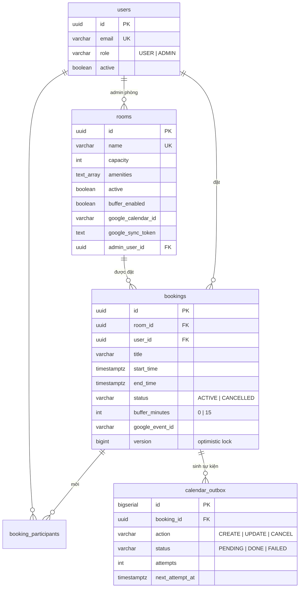

# Meeting Room Booking System — DKI Coding Test

Backend REST API (kèm Web UI demo) cho hệ thống đặt phòng họp nội bộ: công ty ~10 phòng họp,
~200 nhân viên, trước đây đặt phòng bằng nhắn tin nên thường xuyên trùng lịch. Hệ thống này là
nguồn sự thật duy nhất về lịch phòng: quản lý phòng, đặt phòng, xem lịch, tìm phòng trống,
phân quyền người dùng thường / quản trị — và chống trùng lịch tuyệt đối ở tầng database.

Ngoài yêu cầu đề bài, hệ thống có thêm: đồng bộ **hai chiều** với Google Calendar (mỗi phòng
một lịch), buffer time giữa hai cuộc họp bật/tắt theo phòng, mời người tham gia và gửi email
thông báo.

**Stack:** Java 17 · Spring Boot 3.5 · PostgreSQL 16 · Flyway · Docker Compose · React 19 + Vite · Testcontainers

---

## 1. Cách chạy

### Một lệnh duy nhất

```bash
docker compose up --build
```

| Thành phần | URL |
|---|---|
| Web UI (React qua nginx) | http://localhost:3000 |
| API | http://localhost:8080/api/v1 |
| Swagger UI — mô tả và thử từng API | http://localhost:8080/swagger-ui.html |
| Health | http://localhost:8080/actuator/health |
| Mailpit — hộp thư demo nhận email thông báo | http://localhost:8025 |

Không cần cấu hình gì thêm: mọi biến môi trường có default hợp lệ (danh sách trong
`.env.example`). Google Calendar sync **tắt mặc định** nên không cần credential Google.

### Tài khoản mẫu (tự seed khi DB trống)

| Email | Mật khẩu | Vai trò |
|---|---|---|
| `admin@dki.local` | `Admin@123` | ADMIN |
| `alice@dki.local`, `bob@dki.local`, `carol@dki.local` | `User@123` | USER |

10 phòng mẫu seed bằng Flyway: Mercury (4 chỗ) → Jupiter (20 chỗ).

### Chạy dev & test

```bash
docker compose up -d db          # chỉ database
mvn spring-boot:run              # backend local
cd frontend && npm install && npm run dev   # frontend dev, proxy /api sang :8080
mvn test                         # toàn bộ test (cần Docker: Testcontainers kéo postgres:16)
```

### Bật tính năng tùy chọn (qua file `.env`, xem `.env.example`)

- **Google Calendar sync**: đặt service account key tại `./secrets/google-sa.json`, share lịch
  phòng cho email service account quyền "Make changes to events", đặt
  `GOOGLE_CALENDAR_ENABLED=true`, gán Calendar ID cho phòng qua `PUT /rooms/{id}` (hoặc để
  trống khi tạo phòng mới — hệ thống tự tạo lịch).
- **Email thật qua Gmail**: `MAIL_HOST=smtp.gmail.com MAIL_PORT=587 MAIL_SMTP_AUTH=true
  MAIL_STARTTLS=true MAIL_USERNAME=<gmail> MAIL_PASSWORD=<app password> MAIL_FROM=<gmail>`.
  Mặc định mail đi vào Mailpit để xem demo; `MAIL_ENABLED=false` tắt hẳn.

---

## 2. Thiết kế

### 2.1. Kiến trúc

```
┌──────────────┐   /api/v1 (JWT)    ┌─────────────────────────────┐
│  React SPA   │ ─────────────────▶ │  Spring Boot 3 (Java 17)    │
│ (nginx :3000 │ ◀───────────────── │  auth · user · room ·       │
│  proxy /api) │   JSON / RFC7807   │  booking · calendar         │
└──────────────┘                    └──┬─────────┬─────────┬──────┘
                                       │JPA      │outbox10s│ mail (async)
                                       │Flyway   │import30s│
                                       ▼         ▼         ▼
                                 ┌──────────┐ ┌─────────┐ ┌──────────────┐
                                 │PostgreSQL│ │ Google  │ │ SMTP         │
                                 │    16    │ │Calendar │ │ Mailpit/Gmail│
                                 └──────────┘ └─────────┘ └──────────────┘
```

Monolith một module, package theo domain (`auth`, `user`, `room`, `booking`, `calendar`,
`common`); mỗi domain controller → service → repository; DTO là record tách khỏi entity;
schema quản lý bằng Flyway (V1→V8). Hai job nền: outbox processor (đẩy sự kiện lên Google,
10s/lần) và import job (kéo thay đổi từ Google về, 30s/lần). Email gửi async.

### 2.2. Mô hình dữ liệu



Thời gian: nghiệp vụ tính theo `Asia/Ho_Chi_Minh`, DB lưu UTC (`timestamptz`), API nhận/trả
ISO-8601 kèm offset. Không xóa cứng: phòng chỉ tắt (`active=false`), booking chỉ CANCELLED.

### 2.3. Quy tắc nghiệp vụ

| Quy tắc | Lỗi khi vi phạm |
|---|---|
| Căn lưới 15 phút (phút 00/15/30/45) | 422 `NOT_ON_15_MIN_GRID` |
| Thời lượng 15 phút – 8 giờ | 422 `DURATION_TOO_SHORT/_LONG` |
| Trong giờ làm việc 07:00–20:00, cùng một ngày | 422 `OUTSIDE_WORKING_HOURS` |
| Bắt đầu ở tương lai, tối đa 90 ngày tới | 422 `START_IN_PAST` / `TOO_FAR_AHEAD` |
| Số người tham dự ≤ sức chứa phòng | 422 `EXCEEDS_CAPACITY` |
| Phòng đang hoạt động (cả khi sửa booking) | 422 `ROOM_INACTIVE` |
| Không trùng giờ + buffer 15 phút giữa hai booking cùng phòng (bật/tắt theo phòng) | 409 `BOOKING_CONFLICT` kèm `conflict` |
| Người tham gia là user active, không tính người đặt | 422 `PARTICIPANT_NOT_FOUND` |
| Sửa/hủy: chỉ chủ booking hoặc ADMIN; sửa khi chưa bắt đầu; không đổi phòng | 403 / 422 `BOOKING_ALREADY_STARTED` |

### 2.4. API

Base `/api/v1`, JWT Bearer (trừ login/health/swagger). Lỗi chuẩn RFC 7807 kèm `errorCode`
máy đọc được; 409 kèm chi tiết booking chiếm chỗ; lỗi validation kèm `errors[]`.
Chi tiết schema từng API: Swagger UI.

| Nhóm | Endpoint | Quyền | Ghi chú |
|---|---|---|---|
| Auth | `POST /auth/login` | public | → JWT hạn 8h |
| | `GET /auth/me` | user | user nạp lại từ DB mỗi request |
| Users | `POST /users`, `GET /users`, `GET /users/{id}`, `PATCH /users/{id}` | ADMIN | không self-signup; khóa tài khoản hiệu lực tức thì |
| | `POST /users/me/password` | user | đổi mật khẩu |
| | `GET /users/directory` | user | danh bạ rút gọn để chọn người mời họp |
| Rooms | `GET /rooms`, `GET /rooms/{id}` | user | |
| | `POST /rooms`, `PUT /rooms/{id}`, `PATCH /rooms/{id}/status` | ADMIN | tạo phòng: admin phòng mặc định là người tạo; sync bật + không truyền calendar id → tự tạo Google Calendar; toggle buffer |
| | `GET /rooms/availability?start&end&minCapacity&amenities` | user | phòng trống (tính cả buffer), sắp sức chứa tăng dần |
| | `GET /rooms/time-slots?date[&start][&roomId][&excludeBookingId]` | user | nguồn cho picker giờ: giờ bắt đầu hợp lệ + số phòng trống; kèm `start` → giờ kết thúc hợp lệ; mốc kín toàn bộ phòng không trả về; `roomId`+`excludeBookingId` cho form sửa |
| | `GET /rooms/{id}/schedule?from&to` | user | lịch một phòng (≤31 ngày) |
| Bookings | `POST /bookings` | user | body gồm `participantIds[]`; 201; email xác nhận + thư mời |
| | `GET /bookings/{id}` | chủ/ADMIN | |
| | `PUT /bookings/{id}` | chủ/ADMIN | áp lại toàn bộ quy tắc; email cho người thêm/bỏ/giữ |
| | `POST /bookings/{id}/cancel` | chủ/ADMIN | soft-cancel; email báo hủy người tham gia |
| | `GET /bookings/me?from&to&status` | user | mặc định ACTIVE sắp tới |
| | `GET /bookings?roomId&userId&from&to&status` | ADMIN | filter + phân trang |
| | `GET /schedule?date` | user | lịch mọi phòng trong ngày (dashboard) |
| Calendar | `GET /admin/calendar-outbox?status`, `POST /admin/calendar-outbox/{id}/retry` | ADMIN | giám sát + retry đồng bộ Google |

### 2.5. Luồng đặt phòng

1. `GET /rooms/time-slots?date=...` → chọn giờ bắt đầu (chỉ hiện mốc còn đặt được).
2. Thêm `start=` → chọn giờ kết thúc hợp lệ.
3. `GET /rooms/availability` → chọn phòng (phòng vừa đủ xếp trước).
4. `POST /bookings` (kèm người tham gia) → 201; cùng transaction ghi outbox; ~10s sau sự kiện
   lên Google Calendar của phòng; email xác nhận + thư mời gửi async.
5. Trùng lịch → 409 kèm `conflict` để UI hiển thị booking đang chiếm chỗ.

---

## 3. Các quyết định quan trọng và lý do

1. **Chống trùng lịch bằng 3 lớp, lớp cuối là exclusion constraint của PostgreSQL.**
   Khóa dòng phòng (`SELECT ... FOR UPDATE`) tuần tự hóa các request vào cùng phòng; service
   kiểm tra để trả 409 thân thiện kèm chi tiết; và constraint
   `EXCLUDE USING gist (room_id WITH =, booking_busy_range(start_time, end_time, buffer_minutes) WITH &&) WHERE status='ACTIVE'`
   bảo đảm ở tầng DB. *Lý do:* trùng lịch là chính nỗi đau của đề bài; check ở tầng ứng dụng
   luôn thua race condition hoặc bug, ràng buộc DB thì không. Test 10 thread đồng thời cùng
   đặt một slot: đúng 1 thành công.

2. **Buffer time nằm trong chính constraint, snapshot theo booking.** Busy range của mỗi
   booking là `[start, end + buffer riêng)`; buffer bật/tắt theo phòng nhưng mỗi booking chụp
   giá trị tại thời điểm đặt (`buffer_minutes`). *Lý do:* index expression không join được
   sang bảng `rooms`; snapshot giữ được bảo đảm DB tuyệt đối mà vẫn cho phép toggle, và
   booking cũ không bị đổi luật hồi tố.

3. **Đồng bộ Google Calendar chiều đi bằng transactional outbox, không gọi Google trong
   request.** Outbox ghi cùng transaction với booking; processor 3 pha: claim (tx ngắn,
   `FOR UPDATE SKIP LOCKED` + lease) → gọi Google ngoài transaction → ghi kết quả bằng update
   có đích; retry backoff 30s×2ⁿ, quá 6 lần thành FAILED cho admin retry. *Lý do:* đặt phòng
   không được phép chậm hay fail vì Google; restart không mất sự kiện; không giữ connection DB
   qua các call HTTP; update có đích tránh ghi đè booking bằng snapshot cũ (suýt hồi sinh
   booking đã hủy — lỗi tìm ra khi review).

4. **Pre-sync đón đầu khi đặt phòng.** Trước khi vào transaction đặt/sửa, controller chạy một
   lần import nhanh cho riêng phòng đó (best-effort, timeout 2 giây, chạy ngoài transaction).
   *Lý do:* đóng cửa sổ race "tạo sự kiện trên Calendar rồi vài giây sau có người đặt web cùng
   slot" mà không đưa Google vào đường dẫn bắt buộc — Google chậm/chết thì đặt phòng vẫn chạy
   bình thường, sự kiện lấn giờ khi đó sẽ bị gắn nhãn ở vòng poll sau như thiết kế cũ.

5. **Chiều về bằng polling incremental (syncToken), DB thắng khi xung đột.** Sự kiện tạo trên
   lịch phòng thành booking (người đặt: creator khớp email → admin phòng → user hệ thống);
   xóa → CANCELLED; dời giờ → dời theo nếu trống. Sự kiện lấn giờ không giữ được phòng: bị
   đổi tiêu đề trên Google thành `[TRÙNG LỊCH - KHÔNG HỢP LỆ] ...` kèm lý do và lưu DB dạng
   CANCELLED có nhãn để tra cứu. *Lý do:* webhook của Google đòi endpoint HTTPS public —
   không hợp bài chạy local; DB phải thắng vì nó là nguồn sự thật; gắn nhãn thay vì xóa để
   không phá dữ liệu người khác mà lịch vẫn trung thực. Import ghi thẳng repository, không
   qua outbox, để hai chiều không echo lẫn nhau vô hạn.

6. **API time-slots thay vì để client tự tính giờ.** Backend trả giờ bắt đầu/kết thúc hợp lệ
   kèm số phòng trống, ẩn mốc đã kín. *Lý do:* quy tắc (lưới, giờ làm việc, buffer, 90 ngày)
   chỉ nên tồn tại một nơi; UI không bao giờ cho chọn giờ chắc chắn thất bại.

7. **Email best-effort, gửi async, tách khỏi transaction.** Người đặt nhận thư xác nhận;
   người tham gia nhận thư mời / cập nhật / rút / hủy. SMTP chết chỉ sinh log warn; health
   indicator của mail tắt. *Lý do:* thông báo không được phép chặn nghiệp vụ đặt phòng; khác
   với sự kiện Calendar (cần bảo đảm, dùng outbox), mất một email nhắc nhở là chấp nhận được.

8. **JWT HS256 hạn 8 giờ, không refresh token, filter nạp lại user từ DB mỗi request.**
   *Lý do:* đủ cho nội bộ 200 người, đơn giản; nạp lại user khiến khóa tài khoản hiệu lực
   ngay lập tức — đổi lại một query mỗi request, rẻ ở quy mô này.

9. **Optimistic lock (`@Version`) trên booking.** Sửa và hủy đồng thời cùng một booking → một
   bên nhận 409 `CONCURRENT_MODIFICATION`. *Lý do:* chống lost update giữa người dùng và
   admin (hoặc import job) cùng sửa một bản ghi.

10. **Soft-delete toàn hệ thống** (phòng tắt, booking CANCELLED, kể cả booking bị từ chối khi
   import cũng lưu vết). *Lý do:* hệ thống đặt phòng là dữ liệu đối soát — "ai đặt gì, lúc
   nào, vì sao mất slot" phải trả lời được.

11. **Monolith một module, không microservice; không recurring booking, không approval
    workflow.** *Lý do:* 10 phòng, 200 người — tách service chỉ thêm độ phức tạp vận hành mà
    không thêm giá trị; các tính năng ngoài phạm vi được nêu rõ thay vì làm nửa vời.

---

## 4. Kiểm thử

- **Unit:** 13 case biên quy tắc thời gian, backoff outbox, JWT hết hạn.
- **Integration (Testcontainers, PostgreSQL thật):** exclusion constraint (chồng giờ, buffer,
  back-to-back khi tắt buffer), 10 thread đồng thời, đặt/sửa/hủy + 409 kèm `conflict`,
  time-slots (ẩn mốc kín, cap 8h, scoped theo phòng khi sửa), phân quyền 401/403, outbox
  processor (poll thật, retry, FAILED, admin retry), import hai chiều (tạo/hủy/dời/lấn giờ +
  gắn nhãn + chống echo), người tham gia + email (mail sender giả bắt thư).
- CI không gọi Google/SMTP thật — client giả in-memory.

```bash
mvn test
```

## 5. Ngoài phạm vi & hướng mở rộng

- Recurring booking, approval workflow, self-signup, refresh token.
- Check-in/no-show tự giải phóng phòng; né lịch cá nhân người đặt (cần OAuth từng người).
- Rate limiting, audit log chi tiết.
