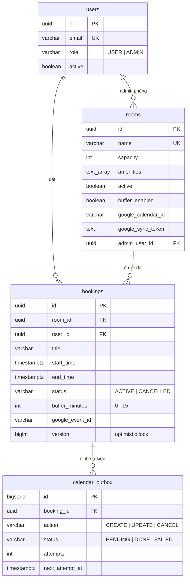

# Meeting Room Booking System

Hệ thống đặt phòng họp nội bộ (~10 phòng, ~200 nhân viên): REST API + Web UI, chống trùng lịch
tuyệt đối ở tầng database, đồng bộ **hai chiều** với Google Calendar (mỗi phòng một lịch),
buffer time bật/tắt theo phòng.

**Stack:** Java 17 · Spring Boot 3.5 · PostgreSQL 16 · Flyway · React 19 + Vite · Docker Compose · Testcontainers

## 1. Chạy dự án

```bash
docker compose up --build
```

| Thành phần | URL |
|---|---|
| Web UI (React + nginx) | http://localhost:3000 |
| Mailpit (hộp thư demo nhận email mời họp) | http://localhost:8025 |
| API | http://localhost:8080/api/v1 |
| Swagger UI (mô tả đầy đủ từng API, thử trực tiếp) | http://localhost:8080/swagger-ui.html |
| Health | http://localhost:8080/actuator/health |

Không cần cấu hình gì: mọi biến môi trường có default (xem `.env.example`). Google Calendar
sync **tắt mặc định** nên không cần credential. Dev frontend: `cd frontend && npm install &&
npm run dev` (proxy `/api` sang `:8080`). Test backend: `mvn test` (cần Docker cho Testcontainers).

### Tài khoản mẫu (seed khi DB trống)

| Email | Mật khẩu | Vai trò |
|---|---|---|
| `admin@dki.local` | `Admin@123` | ADMIN |
| `alice@dki.local` / `bob@dki.local` / `carol@dki.local` | `User@123` | USER |

10 phòng seed bằng Flyway (`V3`): Mercury (4) → Jupiter (20). Tắt seed user: `SEED_ENABLED=false`.

## 2. Luồng hoạt động tổng thể

```
┌──────────────┐   /api/v1 (JWT)    ┌─────────────────────────────┐
│  React SPA   │ ─────────────────▶ │  Spring Boot 3              │
│  (nginx :3000│ ◀───────────────── │  auth · user · room ·       │
│  proxy /api) │   JSON / RFC7807   │  booking · calendar         │
└──────────────┘                    └──────┬───────────────┬──────┘
                                           │ JPA/Flyway    │ outbox 10s · import 30s
                                           ▼               ▼
                                    ┌────────────┐  ┌──────────────────┐
                                    │ PostgreSQL │  │ Google Calendar  │
                                    │  16        │  │ (1 lịch / phòng) │
                                    └────────────┘  └──────────────────┘
```

**DB là nguồn sự thật duy nhất** về phòng trống/bận. Google Calendar là mặt hiển thị và điểm
nhập liệu phụ. Backend chia package theo domain (`auth`, `user`, `room`, `booking`, `calendar`,
`common`), mỗi domain controller → service → repository, DTO là record tách khỏi entity.

### 2.1. Luồng đặt phòng (happy path)

1. Đăng nhập → JWT (hạn 8h). Mọi request sau mang `Authorization: Bearer <token>`.
2. UI gọi `GET /rooms/time-slots?date=...` → danh sách **giờ bắt đầu** hợp lệ (lưới 15 phút,
   07:00–19:45) kèm số phòng trống. Mốc giờ mà mọi phòng đều kín **không được trả về**.
3. Chọn giờ bắt đầu → gọi lại cùng endpoint kèm `start=...` → danh sách **giờ kết thúc** hợp lệ
   (tối đa 8 giờ, không quá 20:00, cắt tại mốc đầu tiên hết phòng).
4. `GET /rooms/availability?start&end` → các phòng trống, sắp theo sức chứa tăng dần.
5. `POST /bookings` → 201. Trong cùng transaction, một dòng `calendar_outbox` được ghi;
   job nền đẩy sự kiện lên Google Calendar của phòng trong ~10 giây.
6. Đặt trùng → 409 kèm object `conflict` (id, tiêu đề, giờ của booking đang chiếm chỗ).

### 2.2. Quy tắc booking (kiểm theo giờ Việt Nam, `Asia/Ho_Chi_Minh`)

| Quy tắc | Lỗi khi vi phạm (422) |
|---|---|
| Căn lưới 15 phút (phút 00/15/30/45) | `NOT_ON_15_MIN_GRID` |
| Thời lượng 15 phút – 8 giờ | `DURATION_TOO_SHORT` / `DURATION_TOO_LONG` |
| Trong 07:00–20:00, cùng một ngày | `OUTSIDE_WORKING_HOURS` |
| Bắt đầu ở tương lai | `START_IN_PAST` |
| Tối đa 90 ngày tới | `TOO_FAR_AHEAD` |
| `endTime > startTime` | `END_BEFORE_START` |
| Số người ≤ sức chứa phòng | `EXCEEDS_CAPACITY` |
| Phòng đang hoạt động | `ROOM_INACTIVE` |
| **Buffer time**: giờ nghỉ 15 phút giữa hai booking cùng phòng | 409 `BOOKING_CONFLICT` |

Buffer time **bật/tắt theo từng phòng** (`rooms.buffer_enabled`, admin chỉnh trong form phòng).
Mỗi booking chụp lại buffer tại thời điểm đặt (`bookings.buffer_minutes` = 0/15) nên tắt buffer
về sau không ảnh hưởng booking cũ. Timeline trên dashboard vẽ dải sọc cho phần buffer.

### 2.3. Chống trùng lịch — 3 lớp

1. **Khóa dòng phòng**: transaction đặt/sửa mở đầu bằng `SELECT ... FOR UPDATE` trên `rooms`
   → request vào cùng phòng chạy tuần tự, phòng khác song song.
2. **Kiểm tra trong service**: busy range của mỗi booking là `[start, end + buffer riêng)`;
   đụng nhau → 409 kèm chi tiết `conflict`.
3. **Exclusion constraint PostgreSQL** (`btree_gist`, hàm IMMUTABLE):
   ```sql
   CONSTRAINT bookings_no_overlap EXCLUDE USING gist
     (room_id WITH =, booking_busy_range(start_time, end_time, buffer_minutes) WITH &&)
     WHERE (status = 'ACTIVE')
   ```
   Bảo đảm cuối cùng ở tầng DB: kể cả khi code có bug, hai booking ACTIVE vi phạm buffer của
   cùng phòng không bao giờ tồn tại. Test 10 thread cùng đặt một slot: đúng 1 thành công, 9 bị 409.

Booking còn có `@Version` (optimistic lock): sửa và hủy đồng thời → một bên 409 `CONCURRENT_MODIFICATION`.

### 2.4. Đồng bộ Google Calendar — hai chiều

**Chiều đi (DB → Google), transactional outbox, 10s/lần:**

```
POST /bookings ─▶ [1 transaction: INSERT bookings + INSERT calendar_outbox PENDING]
Processor:  ① claim batch (FOR UPDATE SKIP LOCKED + lease)      [tx ngắn]
            ② gọi Google API                              [NGOÀI transaction]
            ③ ghi kết quả: DONE / retry backoff 30s×2ⁿ / FAILED sau 6 lần [tx ngắn]
```

Đặt phòng không bao giờ chậm/fail vì Google; app restart không mất sự kiện; thứ tự
CREATE → UPDATE → CANCEL của một booking được giữ; event id lưu bằng UPDATE có đích (không
ghi đè bản ghi cũ). FAILED xem và retry qua API admin. Tạo phòng mới khi sync bật mà không
truyền calendar id → **tự tạo Google Calendar** mang tên phòng.

**Chiều về (Google → DB), incremental import, 30s/lần:**

| Sự kiện trên lịch phòng | Hệ thống |
|---|---|
| Tạo mới, slot trống | Booking ACTIVE. Người đặt: email creator khớp user → user đó; không khớp → **admin của phòng**; không có → user hệ thống `calendar-import@dki.local` |
| Xóa/hủy trên Google | Booking tương ứng → CANCELLED |
| Dời giờ trên Google | Dời booking nếu khung mới trống; đụng lịch thì giữ giờ DB |
| **Lấn giờ** booking có sẵn | Không giữ phòng (DB thắng). Tiêu đề trên Google bị đổi thành `[TRÙNG LỊCH - KHÔNG HỢP LỆ] ...` kèm lý do; DB lưu một booking CANCELLED cùng nhãn để tra cứu |

Cursor đồng bộ là `syncToken` của Google lưu ở `rooms.google_sync_token` (lần đầu: toàn bộ sự
kiện từ hiện tại; token hết hạn 410 → tự full resync). Import ghi thẳng repository, không qua
outbox → không có vòng lặp echo; sự kiện do chính app đẩy lên quay về sẽ no-op vì
`google_event_id` đã khớp. Sự kiện cả ngày bị bỏ qua. Dùng polling vì webhook push đòi HTTPS public.

## 3. API Reference

Base: `/api/v1`. Mọi endpoint (trừ login, health, swagger) yêu cầu `Authorization: Bearer <JWT>`.
Thời gian: ISO-8601 kèm offset (`2026-10-28T09:00:00+07:00`), response luôn trả offset `+07:00`.
Phân trang kiểu Spring: `page`, `size`, `sort` (vd `sort=startTime,desc`), response có `content[]`
và `page{size,number,totalElements,totalPages}`.

**Định dạng lỗi** — RFC 7807 `application/problem+json`:

```json
{ "status": 409, "detail": "...", "errorCode": "BOOKING_CONFLICT",
  "conflict": { "bookingId": "...", "title": "Weekly sync",
                "startTime": "2026-10-28T09:00:00+07:00", "endTime": "...T10:00:00+07:00" } }
```

`errors[]` (field, message) xuất hiện với lỗi validation. Mã lỗi chính: `VALIDATION_ERROR` 400,
`INVALID_RANGE` 400, `UNAUTHORIZED`/`BAD_CREDENTIALS` 401, `FORBIDDEN` 403, `NOT_FOUND` 404,
`BOOKING_CONFLICT`/`CONCURRENT_MODIFICATION` 409, các mã quy tắc nghiệp vụ 422 (mục 2.2, cộng
`EMAIL_TAKEN`, `WRONG_PASSWORD`, `ROOM_NAME_TAKEN`, `ADMIN_USER_NOT_FOUND`, `BOOKING_NOT_ACTIVE`,
`BOOKING_ALREADY_STARTED`, `BOOKING_ALREADY_ENDED`).

### 3.1. Auth

| Method | Path | Quyền | Mô tả |
|---|---|---|---|
| POST | `/auth/login` | public | Body `{email, password}` → `{accessToken, expiresInSeconds, user}`. JWT HS256 hạn 8h. Sai → 401 `BAD_CREDENTIALS`. |
| GET | `/auth/me` | user | Thông tin tài khoản gắn với token. Filter nạp lại user từ DB mỗi request nên tài khoản bị khóa mất quyền ngay. |

### 3.2. Users

| Method | Path | Quyền | Mô tả |
|---|---|---|---|
| POST | `/users` | ADMIN | Tạo tài khoản `{email, fullName, password(≥8), role}` → 201. Trùng email → 422 `EMAIL_TAKEN`. Không có self-signup. |
| GET | `/users` | ADMIN | Danh sách, phân trang. |
| GET | `/users/{id}` | ADMIN | Chi tiết. |
| PATCH | `/users/{id}` | ADMIN | Partial update `{fullName?, role?, active?}`. `active=false` khóa đăng nhập tức thì. |
| POST | `/users/me/password` | user | `{currentPassword, newPassword}` → 204. Sai mật khẩu hiện tại → 422 `WRONG_PASSWORD`. |
| GET | `/users/directory` | user | Danh bạ rút gọn (id, họ tên, email của user active) để chọn người tham gia cuộc họp. |

### 3.3. Rooms

| Method | Path | Quyền | Mô tả |
|---|---|---|---|
| GET | `/rooms?active=true` | user | Danh sách phòng; `active=true` chỉ phòng hoạt động, sắp theo sức chứa tăng dần. |
| GET | `/rooms/{id}` | user | Chi tiết một phòng. |
| POST | `/rooms` | ADMIN | Tạo phòng `{name*, location, capacity*, amenities[], googleCalendarId?, adminUserId?, bufferEnabled?}` → 201. Tên trùng → 422 `ROOM_NAME_TAKEN`. Không truyền `adminUserId` → người tạo là admin phòng. Sync bật + không truyền calendar id → tự tạo Google Calendar mang tên phòng (Google lỗi không chặn tạo phòng). |
| PUT | `/rooms/{id}` | ADMIN | Thay toàn bộ thông tin; `adminUserId` null = giữ nguyên. |
| PATCH | `/rooms/{id}/status` | ADMIN | `{active}` — tắt phòng (soft): ngừng nhận booking mới, không xóa cứng. |
| GET | `/rooms/availability` | user | `?start&end&minCapacity&amenities` → phòng active trống trong `[start,end)` **tính cả buffer từng booking**, lọc sức chứa/tiện nghi (phòng phải có đủ mọi tiện nghi), sắp sức chứa tăng dần. `end ≤ start` → 400 `INVALID_RANGE`. |
| GET | `/rooms/time-slots` | user | Nguồn dữ liệu cho picker giờ. `?date&minCapacity&amenities` → `{startTimes[], endTimes[]}`; mỗi phần tử `{time, availableRooms}`. Thêm `start=` → `endTimes` cho giờ đó (từ start+15', tối đa 8h, ≤20:00, cắt khi hết phòng). Thêm `roomId=` giới hạn một phòng và `excludeBookingId=` bỏ qua booking đang sửa (dùng cho form edit). Mốc kín toàn bộ phòng không được trả về. `date` quá khứ/quá 90 ngày hoặc `start` lệch lưới → 400. |
| GET | `/rooms/{id}/schedule` | user | `?from&to` (mặc định hôm nay, tối đa 31 ngày) → booking ACTIVE của phòng trong khoảng ngày. |

### 3.4. Bookings

| Method | Path | Quyền | Mô tả |
|---|---|---|---|
| POST | `/bookings` | user | `{roomId*, title*, description?, attendeeCount?, startTime*, endTime*, participantIds?[]}` → 201 + header `Location`. Người trong `participantIds` (user active, không tính người đặt) nhận **email mời họp**; id sai → 422 `PARTICIPANT_NOT_FOUND`. Response gồm `participants[]`, `bufferMinutes` và (sau khi sync) `googleEventId`. Vi phạm quy tắc → 422 (mục 2.2); trùng/thiếu buffer → 409 `BOOKING_CONFLICT` + `conflict`. |
| GET | `/bookings/{id}` | chủ booking / ADMIN | Người khác → 403. |
| PUT | `/bookings/{id}` | chủ booking / ADMIN | Sửa `{title*, description?, attendeeCount?, startTime*, endTime*, participantIds?[]}`. Chỉ khi ACTIVE (422 `BOOKING_NOT_ACTIVE`) và chưa bắt đầu (422 `BOOKING_ALREADY_STARTED`). Áp lại toàn bộ quy tắc, kiểm tra lại phòng active. **Không đổi phòng** — hủy rồi đặt mới. Email: người mới thêm nhận thư mời, người bị bỏ nhận thư rút, người giữ nguyên nhận thư cập nhật. |
| POST | `/bookings/{id}/cancel` | chủ booking / ADMIN | Soft-cancel → status CANCELLED, slot giải phóng, **email báo hủy** tới mọi người tham gia. Hủy được khi đang họp; đã kết thúc → 422 `BOOKING_ALREADY_ENDED`; hủy lần hai → 422 `BOOKING_NOT_ACTIVE`. |
| GET | `/bookings/me` | user | `?from&to&status` — mặc định các booking ACTIVE sắp tới của tôi. |
| GET | `/bookings` | ADMIN | Tìm kiếm mọi booking: `?roomId&userId&from&to&status` + phân trang. |
| GET | `/schedule` | user | `?date` (mặc định hôm nay) → lịch mọi phòng active trong ngày, mỗi phòng kèm danh sách booking ACTIVE (kể cả phòng trống lịch). Dashboard dùng endpoint này. |

### 3.5. Calendar outbox (ADMIN)

| Method | Path | Mô tả |
|---|---|---|
| GET | `/admin/calendar-outbox?status=` | Liệt kê bản ghi đồng bộ theo trạng thái (mặc định FAILED): action, attempts, lastError, nextAttemptAt. |
| POST | `/admin/calendar-outbox/{id}/retry` | Đưa bản ghi về PENDING (attempts=0), processor xử lý ở vòng poll kế. |

### 3.6. Ví dụ curl luồng chính

```bash
TOKEN=$(curl -s localhost:8080/api/v1/auth/login -H 'Content-Type: application/json' \
  -d '{"email":"alice@dki.local","password":"User@123"}' | jq -r .accessToken)

# giờ bắt đầu còn trống hôm nay
curl -s "localhost:8080/api/v1/rooms/time-slots" -H "Authorization: Bearer $TOKEN" | jq '.startTimes[:3]'

# phòng trống 09:00-10:00 ngày mai (thay ngày cho đúng)
curl -s "localhost:8080/api/v1/rooms/availability?start=2026-10-28T09:00:00%2B07:00&end=2026-10-28T10:00:00%2B07:00" \
  -H "Authorization: Bearer $TOKEN" | jq '.[].name'

# đặt phòng -> 201; đặt trùng -> 409 kèm .conflict
curl -s -X POST localhost:8080/api/v1/bookings -H "Authorization: Bearer $TOKEN" \
  -H 'Content-Type: application/json' \
  -d '{"roomId":"<ROOM_ID>","title":"Weekly sync","startTime":"2026-10-28T09:00:00+07:00","endTime":"2026-10-28T10:00:00+07:00"}'

# hủy
curl -s -X POST localhost:8080/api/v1/bookings/<BOOKING_ID>/cancel -H "Authorization: Bearer $TOKEN"
```

## 4. Mô hình dữ liệu



Migration Flyway: V1 schema + exclusion constraint · V2 optimistic lock · V3 seed 10 phòng ·
V4 buffer trong constraint · V5 sync token · V6 admin phòng · V7 buffer bật/tắt theo phòng.

## 5. Các quyết định quan trọng & lý do

- **Exclusion constraint + khóa dòng phòng + check service**: ba lớp vì chống trùng lịch là lõi
  của bài toán; lớp DB bảo đảm cả khi dữ liệu được ghi ngoài luồng service.
- **Transactional outbox** thay vì gọi Google trong request: đặt phòng không phụ thuộc Google,
  không mất sự kiện khi restart, retry có kiểm soát, chạy nhiều instance an toàn (SKIP LOCKED).
  Google không bao giờ được gọi trong transaction.
- **Polling import** thay vì webhook: webhook của Google đòi endpoint HTTPS public, không hợp
  môi trường chạy local/docker của bài test; syncToken cho phép poll rẻ.
- **Buffer snapshot trên booking** (`buffer_minutes`): để constraint DB enforce được quy tắc
  theo phòng mà không cần join sang `rooms` trong index expression.
- **Soft-cancel / soft-deactivate**: giữ toàn bộ lịch sử phục vụ đối soát.
- **JWT HS256 hạn 8h, không refresh token**: đủ cho nội bộ; filter reload user mỗi request nên
  khóa tài khoản hiệu lực tức thì.
- **Event không mời attendee mặc định**: service account bị Google chặn gắn `attendees`
  (403 `forbiddenForServiceAccounts`) nếu không có Domain-Wide Delegation; email người đặt nằm
  trong mô tả sự kiện. Bật mời qua `GOOGLE_CALENDAR_INVITE_BOOKER=true` + `GOOGLE_IMPERSONATE_USER`.
- **Seed user bằng ApplicationRunner** (tránh hardcode BCrypt hash trong SQL), seed phòng bằng
  Flyway (idempotent, ON CONFLICT).
- **Email mời họp best-effort, gửi async**: SMTP chết chỉ sinh log warn, không chặn đặt phòng.
  Compose kèm Mailpit (SMTP sink, UI :8025) để xem email demo; tắt bằng `MAIL_ENABLED=false`.
  Health check SMTP bị tắt để mail server chết không kéo `/actuator/health` DOWN.

## 6. Bật Google Calendar sync

1. Google Cloud: bật **Calendar API**, tạo **service account**, tải JSON key → đặt tại
   `./secrets/google-sa.json`.
2. Với lịch phòng có sẵn: share lịch cho email service account với quyền **Make changes to
   events**, lấy Calendar ID, gán qua `PUT /rooms/{id}` (`googleCalendarId`). Hoặc để trống và
   tạo phòng mới — hệ thống tự tạo calendar (lưu ý: calendar do service account tạo cần share
   lại cho người dùng muốn xem).
3. Chạy với `GOOGLE_CALENDAR_ENABLED=true` (qua file `.env`).
4. Giám sát: `GET /admin/calendar-outbox?status=FAILED`, retry từng bản ghi; log import có
   `Imported ...` / `rejected`.

Biến môi trường: `GOOGLE_CALENDAR_POLL_INTERVAL_MS` (outbox, mặc định 10000),
`GOOGLE_CALENDAR_IMPORT_INTERVAL_MS` (import, mặc định 30000).

## 7. Kiểm thử

- **Unit**: 13 case biên quy tắc thời gian, backoff outbox, JWT hết hạn.
- **Integration (Testcontainers, PostgreSQL thật)**: exclusion constraint (chồng giờ, buffer,
  back-to-back khi tắt buffer), 10 thread đồng thời đúng 1 thắng, đặt/sửa/hủy + 409 kèm
  `conflict`, time-slots (ẩn mốc kín, 8h cap, room-scoped + exclude khi edit), phân quyền
  401/403, outbox processor (poll thật, retry, FAILED, admin retry, 404 Google), import hai
  chiều (tạo/hủy/dời/lấn giờ + gắn nhãn + trace CANCELLED, chống echo), phòng tắt buffer.
- CI không gọi Google thật; Google client là fake in-memory trong test.

## 8. Ngoài phạm vi & hướng mở rộng

- Recurring booking, approval workflow, self-signup, refresh token.
- Check-in/no-show tự giải phóng phòng; thông báo email/Slack (outbox sẵn sàng mở rộng).
- Né lịch cá nhân người đặt (cần OAuth từng người hoặc share lịch cá nhân).
- Rate limiting, audit log chi tiết.
