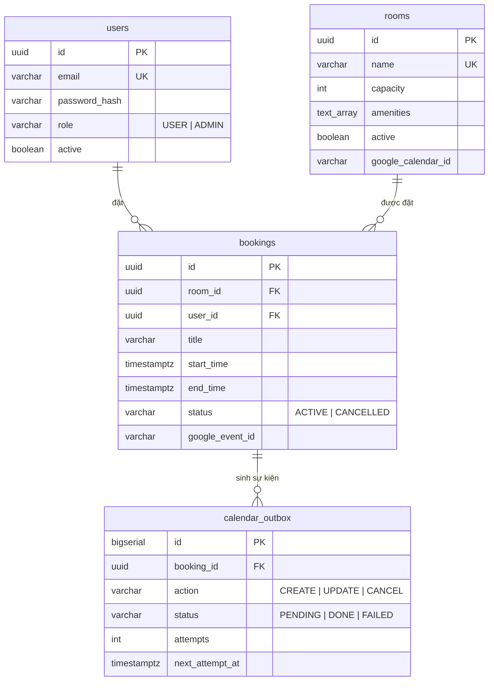

# Meeting Room Booking API

Backend REST API cho hệ thống đặt phòng họp nội bộ (~10 phòng, ~200 nhân viên): quản lý phòng,
đặt / sửa / hủy booking, xem lịch, tìm phòng trống, phân quyền USER / ADMIN và đồng bộ booking
lên Google Calendar theo từng phòng.

**Stack:** Java 17 · Spring Boot 3.5 · PostgreSQL 16 · Flyway · Docker Compose · Testcontainers

## 1. Chạy dự án

### Docker (khuyến nghị)

```bash
docker compose up --build
```

- API: http://localhost:8080
- Swagger UI: http://localhost:8080/swagger-ui.html
- Health: http://localhost:8080/actuator/health

Không cần cấu hình gì thêm: mọi biến môi trường có default (xem `.env.example`).
Google Calendar sync **tắt mặc định** nên không cần credential.

### Chạy local (cần PostgreSQL)

```bash
docker compose up -d db
mvn spring-boot:run
```

### Test

```bash
mvn test        # cần Docker đang chạy (Testcontainers tự kéo postgres:16-alpine)
```

### Frontend (React, thư mục `frontend/`)

```bash
cd frontend
npm install
npm run dev     # http://localhost:5173 (tự nhảy port nếu bận), proxy /api sang backend :8080
```

SPA React 19 + TypeScript + Vite dùng toàn bộ API: đăng nhập, dashboard lịch ngày theo phòng,
tìm phòng trống & đặt, booking của tôi (sửa/hủy), quản lý phòng, và cho ADMIN: người dùng,
mọi booking, giám sát + retry calendar outbox. Trang "Luồng hoạt động" giải thích toàn bộ
kiến trúc và các luồng. Dev server proxy `/api` nên không cần CORS.

## 2. Tài khoản mẫu (seed khi DB trống)

| Email | Mật khẩu | Vai trò |
|---|---|---|
| `admin@dki.local` | `Admin@123` | ADMIN |
| `alice@dki.local` | `User@123` | USER |
| `bob@dki.local` | `User@123` | USER |
| `carol@dki.local` | `User@123` | USER |

10 phòng mẫu seed bằng Flyway (`V3__seed_rooms.sql`): Mercury (4), Venus (6), Mekong (7), Earth (8),
Danang (9), Hanoi (10), Mars (12), Saigon (14), Halong (16), Jupiter (20). Earth được gán sẵn
calendar test của công ty. Tài khoản seed bằng `ApplicationRunner`, tắt bằng `SEED_ENABLED=false`.

## 3. Luồng dùng thử nhanh (curl)

```bash
# 1. Đăng nhập
TOKEN=$(curl -s localhost:8080/api/v1/auth/login \
  -H 'Content-Type: application/json' \
  -d '{"email":"alice@dki.local","password":"User@123"}' | jq -r .accessToken)

# 2. Tìm phòng trống ngày mai 09:00-10:00, tối thiểu 6 chỗ
curl -s "localhost:8080/api/v1/rooms/availability?start=2026-10-28T09:00:00%2B07:00&end=2026-10-28T10:00:00%2B07:00&minCapacity=6" \
  -H "Authorization: Bearer $TOKEN" | jq '.[].name'

# 3. Đặt phòng (lấy roomId từ bước 2)
curl -s -X POST localhost:8080/api/v1/bookings \
  -H "Authorization: Bearer $TOKEN" -H 'Content-Type: application/json' \
  -d '{"roomId":"<ROOM_ID>","title":"Weekly sync","attendeeCount":6,
       "startTime":"2026-10-28T09:00:00+07:00","endTime":"2026-10-28T10:00:00+07:00"}'

# 4. Đặt trùng slot -> 409 kèm booking đang chiếm chỗ
#    {"status":409,"errorCode":"BOOKING_CONFLICT","conflict":{"bookingId":"...","title":"Weekly sync",...}}

# 5. Hủy
curl -s -X POST localhost:8080/api/v1/bookings/<BOOKING_ID>/cancel -H "Authorization: Bearer $TOKEN"
```

## 4. API

Prefix `/api/v1`. Chi tiết đầy đủ (schema, mô tả, thử trực tiếp) trong Swagger UI.

| Nhóm | Endpoint | Quyền |
|---|---|---|
| Auth | `POST /auth/login`, `GET /auth/me` | public / user |
| Users | `POST /users`, `GET /users`, `GET /users/{id}`, `PATCH /users/{id}` | ADMIN |
| | `POST /users/me/password` | user |
| Rooms | `GET /rooms`, `GET /rooms/{id}`, `GET /rooms/availability`, `GET /rooms/time-slots` | user |
| | `POST /rooms`, `PUT /rooms/{id}`, `PATCH /rooms/{id}/status` | ADMIN |
| Bookings | `POST /bookings`, `GET /bookings/{id}`, `PUT /bookings/{id}`, `POST /bookings/{id}/cancel`, `GET /bookings/me` | user (chủ booking hoặc ADMIN) |
| | `GET /bookings` (filter + phân trang) | ADMIN |
| Schedule | `GET /rooms/{id}/schedule?from&to`, `GET /schedule?date` | user |
| Calendar | `GET /admin/calendar-outbox?status`, `POST /admin/calendar-outbox/{id}/retry` | ADMIN |

Lỗi theo RFC 7807 (`application/problem+json`) kèm `errorCode` máy đọc được;
riêng 409 có thêm `conflict` (booking đang chiếm chỗ); lỗi validation có `errors[]`.

## 5. Quy tắc nghiệp vụ

- Giờ nghiệp vụ: `Asia/Ho_Chi_Minh`. API nhận/trả ISO-8601 kèm offset; DB lưu `timestamptz` (UTC).
- Booking: lưới 15 phút; dài 15 phút – 8 giờ; trong 07:00–20:00 cùng một ngày; tối đa 90 ngày tới;
  `attendeeCount` ≤ sức chứa phòng; **giờ nghỉ 15 phút** giữa hai booking cùng phòng (back-to-back
  bị 409; 9:00–10:00 rồi 10:15–11:00 là hợp lệ). Exclusion constraint nới `end_time` thêm 15 phút
  (hàm IMMUTABLE `booking_busy_range`) nên quy tắc này được DB bảo đảm cả khi đồng thời.
- `GET /rooms/time-slots?date&minCapacity&amenities[&start]`: trả danh sách giờ bắt đầu hợp lệ
  (lưới 15 phút, 07:00–19:45) kèm số phòng trống; truyền `start` sẽ trả thêm danh sách giờ kết
  thúc hợp lệ cho giờ đó (tối đa 8 giờ, không quá 20:00). Mốc giờ kín toàn bộ phòng không được
  trả về — UI chỉ cho chọn giờ chắc chắn đặt được.
- Sửa booking: chỉ chủ booking hoặc ADMIN, khi còn ACTIVE và chưa bắt đầu. Không đổi phòng
  (hủy rồi đặt mới để lịch sử rõ ràng).
- Hủy: đổi trạng thái sang CANCELLED (soft-cancel), hủy được cả khi đang họp, không hủy được
  booking đã kết thúc.
- Phòng: không xóa cứng, chỉ vô hiệu hóa (`active=false`) để giữ lịch sử booking.
- Người dùng: ADMIN tạo tài khoản (không self-signup). Tài khoản bị khóa mất hiệu lực token ngay.

## 6. Kiến trúc & quyết định quan trọng

### Chống trùng lịch — 3 lớp (quyết định cốt lõi)

1. **Khóa dòng phòng**: transaction đặt/sửa booking mở đầu bằng `SELECT ... FOR UPDATE` trên
   dòng `rooms` (`RoomRepository.findByIdForUpdate`). Request vào cùng một phòng được xử lý
   tuần tự; phòng khác không ảnh hưởng. Với 10 phòng, chi phí khóa không đáng kể.
2. **Kiểm tra overlap trong service**: trả 409 kèm thông tin booking đang chiếm chỗ để client
   hiển thị thân thiện.
3. **Exclusion constraint của PostgreSQL** (`btree_gist`):
   ```sql
   CONSTRAINT bookings_no_overlap EXCLUDE USING gist
     (room_id WITH =, tstzrange(start_time, end_time, '[)') WITH &&)
     WHERE (status = 'ACTIVE')
   ```
   Lớp bảo đảm cuối cùng ở tầng DB: kể cả khi code có bug hay dữ liệu được ghi ngoài luồng
   service, hai booking ACTIVE chồng giờ của cùng phòng không bao giờ tồn tại.
   `BookingConcurrencyTest` bắn 10 thread cùng đặt một slot: đúng 1 thành công, 9 nhận 409.

### Đồng bộ Google Calendar — transactional outbox

Mỗi phòng map tới một Google Calendar (`rooms.google_calendar_id`). Khi tạo/sửa/hủy booking,
một bản ghi được ghi vào bảng `calendar_outbox` **trong cùng transaction** với booking.
Scheduler (10s/lần) đọc outbox bằng `FOR UPDATE SKIP LOCKED`, gọi Google API, retry với
backoff lũy tiến (30s × 2ⁿ, tối đa 6 lần) rồi đánh FAILED cho admin xem và retry qua API.

Lý do: đặt phòng không bao giờ fail hay chậm vì Google; không mất sự kiện khi app restart;
thứ tự CREATE → UPDATE → CANCEL của một booking được giữ (sort theo `booking_id, id`);
chạy nhiều instance vẫn an toàn nhờ SKIP LOCKED. Đổi lại sự kiện lên Google trễ vài giây —
chấp nhận được cho nghiệp vụ đặt phòng.

### Tự tạo Google Calendar theo phòng

Khi `GOOGLE_CALENDAR_ENABLED=true` và admin tạo phòng **không** kèm `googleCalendarId`,
hệ thống tự tạo một Google Calendar mới mang tên phòng (timezone Asia/Ho_Chi_Minh, thuộc
sở hữu service account) và gán vào phòng. Google lỗi không chặn việc tạo phòng: phòng vẫn
được tạo với calendar trống, admin gán sau qua `PUT /rooms/{id}`.

Lưu ý: calendar do service account tạo không tự hiện trong Google Calendar của nhân viên;
muốn người thường xem được thì share calendar đó (qua ACL API hoặc tạo calendar bằng tài
khoản công ty rồi truyền `googleCalendarId` khi tạo phòng).

### Các quyết định khác

- **JWT HS256, không refresh token**: hết hạn 8h (một ngày làm việc); đơn giản đúng mức cho
  nội bộ 200 người. Filter reload user từ DB mỗi request nên khóa tài khoản có hiệu lực tức thì.
- **Soft-cancel / soft-deactivate**: giữ toàn bộ lịch sử phục vụ đối soát.
- **Không có recurring booking & approval workflow**: ngoài phạm vi, nêu rõ ở mục 8.
- **Lịch sự kiện không mời attendee mặc định**: service account thường bị Google chặn gắn
  `attendees` (403 `forbiddenForServiceAccounts`) nếu không có Domain-Wide Delegation.
  Email người đặt ghi trong mô tả sự kiện. Bật mời qua `GOOGLE_CALENDAR_INVITE_BOOKER=true`
  + `GOOGLE_IMPERSONATE_USER` khi Workspace đã cấp DWD.
- **Seed bằng ApplicationRunner** thay vì SQL migration: tránh hardcode BCrypt hash trong SQL,
  idempotent (chỉ chạy khi bảng trống), tắt được bằng env.

### ERD



Cấu trúc package theo domain: `auth`, `user`, `room`, `booking`, `calendar`, `common`;
mỗi domain gồm controller → service → repository, DTO là record tách khỏi entity.

## 7. Bật Google Calendar sync

1. Tạo Google Cloud project, bật **Google Calendar API**, tạo **service account** và tải JSON key.
2. Trên Google Calendar của công ty, tạo một lịch con cho mỗi phòng; share từng lịch cho email
   của service account với quyền **Make changes to events**. Lấy Calendar ID trong phần cài đặt lịch.
3. Đặt key tại `./secrets/google-sa.json` (compose mount sẵn vào `/secrets/google-sa.json`).
4. Chạy với `GOOGLE_CALENDAR_ENABLED=true` (vd qua file `.env`).
5. Gán lịch cho phòng: `PUT /api/v1/rooms/{id}` với `googleCalendarId: "<calendar-id>"`.
6. (Tùy chọn, cần Domain-Wide Delegation) `GOOGLE_CALENDAR_INVITE_BOOKER=true` và
   `GOOGLE_IMPERSONATE_USER=<user@domain>` để người đặt nhận lời mời vào lịch cá nhân.

Giám sát: `GET /api/v1/admin/calendar-outbox?status=FAILED`, retry từng bản ghi qua
`POST /api/v1/admin/calendar-outbox/{id}/retry`.

## 8. Ngoài phạm vi & hướng mở rộng

- Recurring booking (đặt lặp), approval workflow, self-signup, refresh token.
- Đồng bộ ngược Google Calendar → hệ thống (webhook push).
- Thông báo (email/Slack) khi booking thay đổi — outbox sẵn sàng mở rộng cho việc này.
- Rate limiting, audit log chi tiết.

## 9. Kiểm thử

- **Unit**: quy tắc thời gian (`BookingRuleValidatorTest` — 13 case biên), backoff outbox, JWT.
- **Integration (Testcontainers PostgreSQL thật)**: exclusion constraint, đặt/sửa/hủy, 409 kèm
  `conflict`, 10 thread đồng thời, phân quyền 401/403, tìm phòng trống, lịch, outbox processor
  với Google client giả (tạo/retry/FAILED/admin retry/404).
- CI không gọi Google thật.
